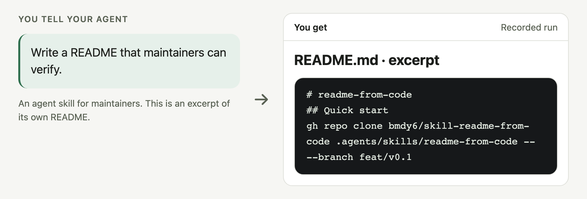
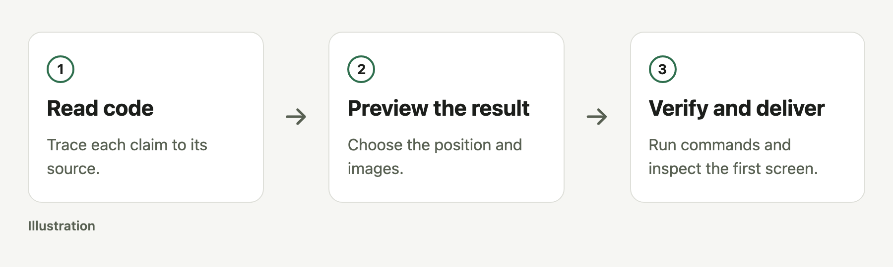

# readme-from-code

Help maintainers write a verifiable README with tested commands and clear images using an agent skill.

[简体中文](README.zh-CN.md) · [MIT](LICENSE)

<picture>
  <source media="(prefers-color-scheme: dark)" srcset="docs/readme/hero-dark.png">
  
</picture>

An actual README excerpt, captured from this repository.

## Quick start

```sh
gh repo clone bmdy6/skill-readme-from-code .agents/skills/readme-from-code -- --branch feat/v0.1
```

Then tell your agent:

> Use readme-from-code to write a source-backed README for this repo.

Requires authenticated gh access, Node 20+, Chromium, and a skill-capable agent; network for setup.

## What you get

- **Traceable claims.** Each fact points to a source file and line.
- **Actual execution.** README commands run in disposable copies of the project.
- **Readable evidence.** Render light, dark, English, and Chinese images with automated self-checks.

## How it works

<picture>
  <source media="(prefers-color-scheme: dark)" srcset="docs/readme/workflow-dark.png">
  
</picture>

## Options

| Option | Purpose |
|---|---|
| `audit` | Report without changing the target. |
| `verify` | Check commands, images, and the first screen. |
| `--online` | Also check external links. |

See the [command reference](docs/reference.md).

## FAQ and boundaries

**Does it merge or change settings?** No; it delivers files, suggestions, and a PR.

**What do I decide?** Interactive runs ask you to choose a position and approve the first-screen preview.

**Is image data real?** Terminal text comes from captures; diagrams are labeled illustrations. This hero shows an actual README excerpt.

**Can I install remotely?** This private preview requires authenticated gh access and installs the feat/v0.1 branch; unauthenticated installation is unverified.

<details><summary>Execution boundary</summary>

Disposable copies are not OS sandboxes. Run trusted projects only; source citations still need human judgment.

</details>

## Contributing

Submit a reproducible issue or PR, and run npm test.

## License

[MIT](LICENSE).
