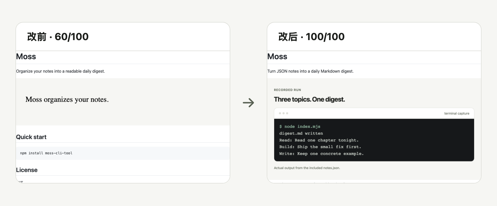
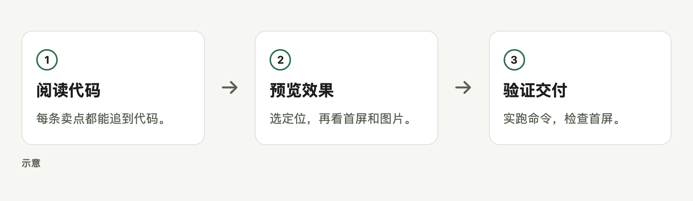

# readme-from-code

把代码变成别人想试的 README：命令都跑过，第一屏都看过。

[English](README.md) · [MIT](LICENSE) · 已在 Codex 上实测；任何能读 SKILL.md 的 agent 都可以按此流程使用。

<picture>
  <source media="(prefers-color-scheme: dark)" srcset="docs/readme/hero-dark.zh-CN.png">
  
</picture>

审计分 = README 检查通过项占比（同一 CLI 样例的改写前后）。

## 快速开始

```sh
gh repo clone bmdy6/skill-readme-from-code .agents/skills/readme-from-code
```

然后告诉智能体：

> 用 readme-from-code，为这个仓库写一份有代码依据的介绍。

需要已认证的 gh、Node 20+、Chromium 和支持技能的智能体；安装需联网。

## 你会得到什么

- **可追溯的卖点。** 每条事实都指向来源文件和行号。
- **真实执行。** 在项目临时副本中运行 README 命令。
- **清晰的证据。** 生成浅色、深色和中英文图片，并执行自动自检。

## 如何工作

<picture>
  <source media="(prefers-color-scheme: dark)" srcset="docs/readme/workflow-dark.zh-CN.png">
  
</picture>

## 选项

| 选项 | 用途 |
|---|---|
| `tidy` | 整理 README 结构，登记个别文案修改并校验正文保留。 |
| `audit` | 只出报告，不改目标。 |
| `verify` | 检查命令、图片和首屏。 |
| `--online` | 额外检查外链。 |

完整说明见[命令参考](docs/reference.md)。

## 常见问题和边界

**会直接改仓库设置或合并吗？** 不会，只交付文件、建议和 PR。

**需要我做哪些决定？** 交互模式会让你选择一句话定位，并确认首屏预览。

**图里的数据可信吗？** 终端文本来自真实 capture，流程示意会明确标注；本页展示样例真实的改写前后首屏。

**能直接在线安装吗？** 当前私有预览需要已认证的 gh，安装 main 分支；无凭据安装未验证。

**审计分数代表什么？** 它统计 README 检查通过率，不是访客评分。

<details><summary>使用边界</summary>

临时副本不是操作系统沙箱，只对可信项目运行命令；事实引用仍需人工判断。

</details>

## 参与贡献

请提交可复现问题或 PR，并运行 npm test。

## 许可证

[MIT](LICENSE)。
