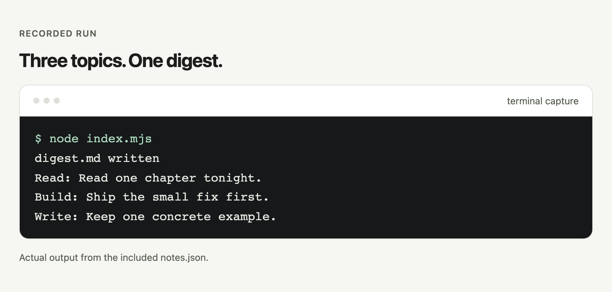

# Moss

Turn JSON notes into a daily Markdown digest.

<picture>
  <source media="(prefers-color-scheme: dark)" srcset="assets/hero-dark.png">
  
</picture>

Moss prints a summary after writing the digest.

## Quick start

```sh
node index.mjs
```

Moss reads the included `notes.json` and writes `digest.md` in your current directory.

Requires Node.js 20 or later.

## What you get

- Notes sharing a topic appear together.
- Markdown headings and bullet lists make the digest readable.
- Console summaries show each topic and its notes.

## How it works

- Moss reads and parses the JSON source.
- It groups each note’s `text` by its `topic`.
- It writes the Markdown digest and prints summaries.

## Options

| Argument | Behavior |
| --- | --- |
| Source file | Pass a JSON path after `node index.mjs`. If omitted, Moss uses the included `notes.json`. |

See the [reference](docs/reference.md) for documentation.

## FAQ and boundaries

### What input does Moss expect?

Use a JSON array of objects with `topic` and `text` fields, as shown in `notes.json`.

### Does it run automatically each day?

No. Each command invocation creates a digest; the code includes no scheduler or date filtering.

### Will it preserve an existing digest?

No. Each run overwrites `digest.md` in the current directory.

## Contributing

Test changes from the checkout with `node index.mjs`, then inspect `digest.md` and the console summaries.

## License

Moss uses the [MIT License](LICENSE).
