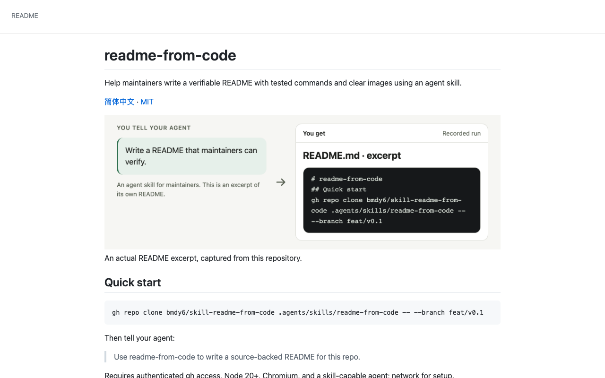
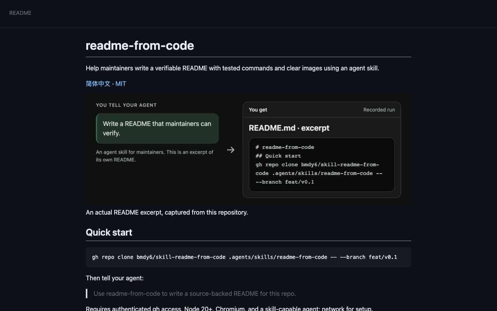
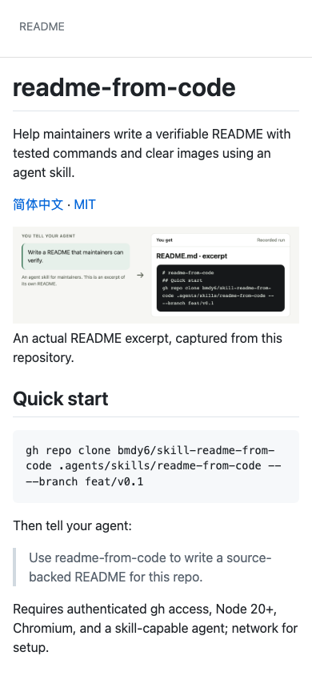
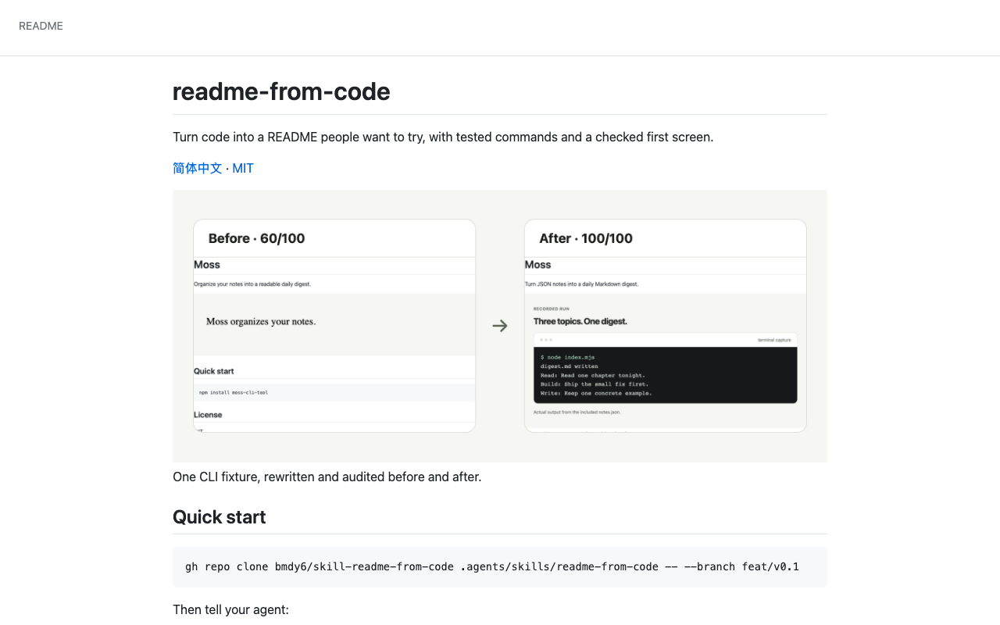
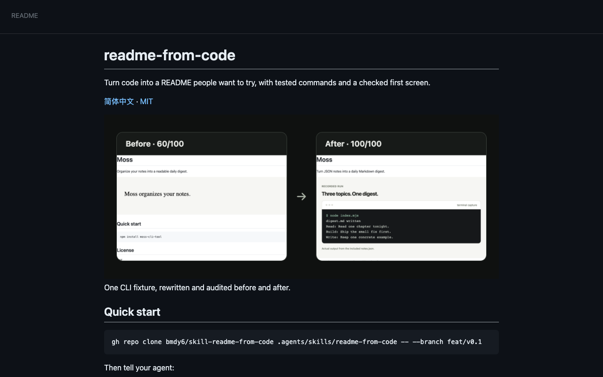
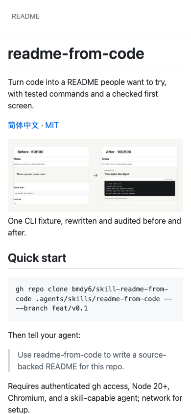

# README delivery

Before: 83/100. After: 100/100.

## Verification

| Check | Status | Evidence |
|---|---|---|
| V1 | pass | Passed |
| V2 | pass | Passed |
| V3 | pass | Passed |
| V4 | pass | Passed |
| V5 | pass | Passed |
| V6 | pass | Passed |
| V7 | pass | Passed |
| V8 | pass | Passed |
| V9 | pass | Passed |
| V10 | pass | Passed |
| V11 | pass | Passed |

## Stranger

{
  "status": "pass",
  "checks": {
    "what": true,
    "forWhom": true,
    "firstCommand": true,
    "wouldTry": true,
    "whatOutput": true
  },
  "answers": {
    "what": "An agent skill that turns source code into a README, with tested commands and a checked first screen.",
    "forWhom": "Developers using coding agents who want clearer, more compelling project READMEs.",
    "firstCommand": "gh repo clone bmdy6/skill-readme-from-code .agents/skills/readme-from-code -- --branch feat/v0.1",
    "wouldTry": "yes",
    "why": "The before-and-after example shows a concrete improvement, and testing the documented commands sounds useful.",
    "whatOutput": "A rewritten README with a clearer description, quick-start instructions, and visual evidence of the project running. The example includes a terminal capture showing a generated Markdown digest.",
    "mostAppealing": "The promise of tested commands backed by a visible before-and-after example.",
    "confusing": [
      "The next instruction after cloning is below the visible screen.",
      "It does not say which coding agents support the skill or what prerequisites are needed.",
      "The 60/100 and 100/100 scores have no visible explanation.",
      "It is unclear whether terminal captures and other visuals are generated automatically."
    ]
  }
}

## Blind choice

{
  "status": "pass",
  "winner": "after",
  "answers": {
    "choice": "B",
    "why": "The before-and-after comparison makes the benefit concrete and gives me a stronger reason to try it. A mostly shows an installation command, which demonstrates less value.",
    "confusing": [
      "B’s 60/100 and 100/100 scores have no visible scoring criteria, so they feel self-assigned."
    ]
  },
  "randomization": {
    "method": "crypto.randomInt(2)",
    "draw": 0
  },
  "labels": {
    "A": {
      "source": "before",
      "sha256": "cdc858caca5252b1047b361919a0fdb0b317fb2033569269271b1cd3b8690a7f"
    },
    "B": {
      "source": "after",
      "sha256": "9b25a6e80be1cec6ee217a4771e7b629f9f834a9eff815310ade89445f27da40"
    }
  }
}

## Images

- hero-light.png: real; self-check pass
- hero-dark.png: real; self-check pass
- hero-light.zh-CN.png: real; self-check pass
- hero-dark.zh-CN.png: real; self-check pass
- workflow-light.png: illustration; self-check pass
- workflow-dark.png: illustration; self-check pass
- workflow-light.zh-CN.png: illustration; self-check pass
- workflow-dark.zh-CN.png: illustration; self-check pass

## Gates

G1: agent. G2: agent.

{
  "G1": {
    "decidedBy": "agent",
    "originalTagline": "Help maintainers write a verifiable README with tested commands and clear images using an agent skill.",
    "candidates": [
      "Turn code into a README people want to try, with tested commands and a checked first screen.",
      "A source-backed README, with commands run and screenshots checked.",
      "Give repository visitors a README they can understand and try."
    ],
    "adaptedFromOld": "A source-backed README, with commands run and screenshots checked.",
    "choice": "Turn code into a README people want to try, with tested commands and a checked first screen.",
    "reason": "Round 2 requires the project outcome and concrete output, with the useful original tagline preserved as a candidate."
  },
  "G2": {
    "decidedBy": "agent",
    "choice": "Approved after round 2 core-output and baseline comparison review",
    "reason": "Inspected actual input/output heroes at 900px, light/dark variants, desktop and mobile first screens; primary text and content bounds pass R4. Independent readers and randomized blind choice passed."
  }
}

## Intentional deletions

[]

## Not verified

- External links only checked when --online was requested.
- Renderer: github-api.
