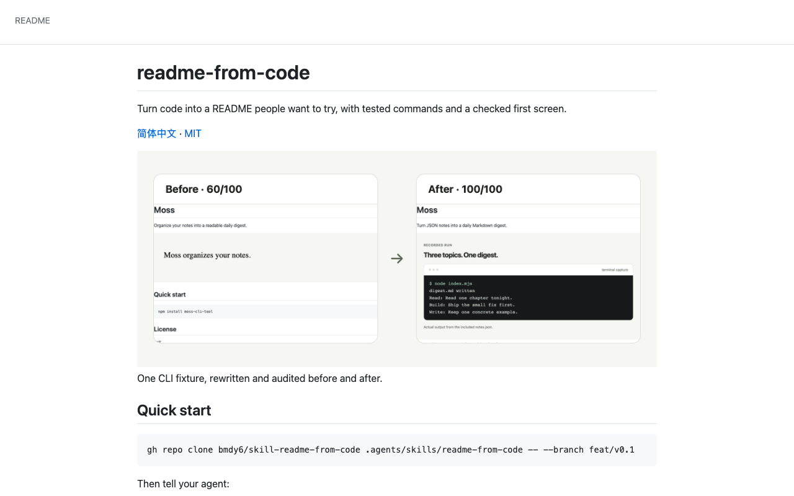
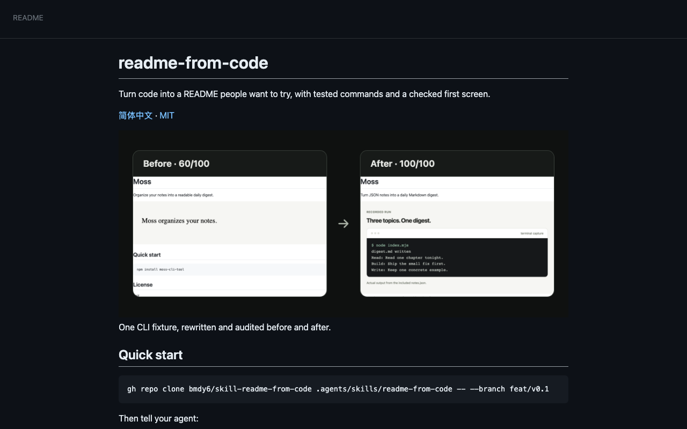
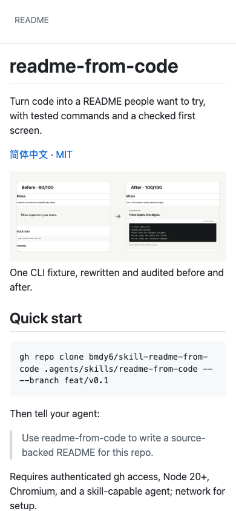
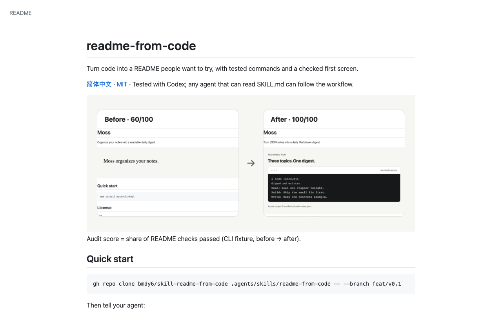
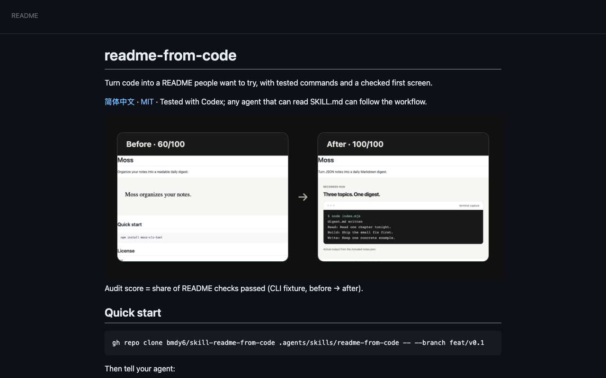
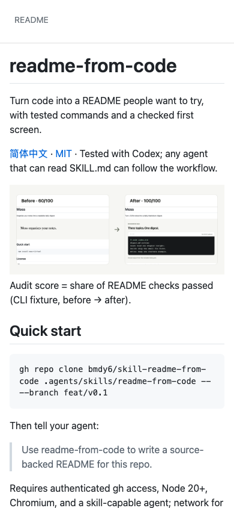

# README delivery

Before: 100/100. After: 100/100.

## Verification

| Check | Status | Evidence |
|---|---|---|
| V1 | pass | Passed |
| V2 | pass | Passed |
| V3 | pass | Passed |
| V4 | pass | Passed |
| V5 | pass | Passed |
| V6 | pass | Passed |
| V7 | pass | Passed |
| V8 | pass | Passed |
| V9 | pass | Passed |
| V10 | pass | Passed |
| V11 | pass | Passed |

## Stranger

{
  "status": "fail",
  "checks": {
    "what": true,
    "forWhom": false,
    "firstCommand": true,
    "wouldTry": true,
    "whatOutput": true
  },
  "answers": {
    "what": "An agent skill that turns code into a README with tested commands and a checked first screen.",
    "forWhom": "Developers using Codex or another agent that can follow SKILL.md instructions.",
    "firstCommand": "gh repo clone bmdy6/skill-readme-from-code .agents/skills/readme-from-code -- --branch feat/v0.1",
    "wouldTry": "yes",
    "why": "The before-and-after example makes the improvement tangible, and testing the commands addresses a common README frustration.",
    "whatOutput": "An improved README with a clearer description, quick-start instructions, and a visual example of actual output. The sample shows a terminal running a notes-to-Markdown digest command.",
    "mostAppealing": "The promise of commands that have actually been tested.",
    "confusing": [
      "The agent prompt after installation is below the visible screen.",
      "The 100/100 score lacks visible detail about which checks passed.",
      "The example text is too small to assess the improvement closely.",
      "It is unclear whether the workflow produces screenshots automatically or requires user involvement."
    ]
  }
}

## Blind choice

{
  "status": "pass",
  "winner": "after",
  "answers": {
    "choice": "A",
    "why": "A explains what the audit scores measure and says the workflow was tested with Codex, giving me more confidence to try it.",
    "confusing": [
      "The 100/100 score reflects README checks, but the screenshots do not show what those checks are."
    ]
  },
  "randomization": {
    "method": "crypto.randomInt(2)",
    "draw": 1
  },
  "labels": {
    "A": {
      "source": "after",
      "sha256": "e6200263f6d3691178c97c78b4a294041f43882c09c45d3a312287de8eacbb79"
    },
    "B": {
      "source": "before",
      "sha256": "9b25a6e80be1cec6ee217a4771e7b629f9f834a9eff815310ade89445f27da40"
    }
  }
}

## Images

- hero-light.png: real; self-check pass
- hero-dark.png: real; self-check pass
- hero-light.zh-CN.png: real; self-check pass
- hero-dark.zh-CN.png: real; self-check pass
- workflow-light.png: illustration; self-check pass
- workflow-dark.png: illustration; self-check pass
- workflow-light.zh-CN.png: illustration; self-check pass
- workflow-dark.zh-CN.png: illustration; self-check pass

## Gates

G1: agent. G2: agent.

{
  "G1": {
    "decidedBy": "agent",
    "originalTagline": "Help maintainers write a verifiable README with tested commands and clear images using an agent skill.",
    "candidates": [
      "Turn code into a README people want to try, with tested commands and a checked first screen.",
      "A source-backed README, with commands run and screenshots checked.",
      "Give repository visitors a README they can understand and try."
    ],
    "adaptedFromOld": "A source-backed README, with commands run and screenshots checked.",
    "choice": "Turn code into a README people want to try, with tested commands and a checked first screen.",
    "reason": "Round 2 requires the project outcome and concrete output, with the useful original tagline preserved as a candidate."
  },
  "G2": {
    "decidedBy": "agent",
    "choice": "Approved after round 2 core-output and baseline comparison review",
    "reason": "Round 3: inspect the actual score comparison, calculation caption and light/dark first screens before delivery."
  }
}

## Intentional deletions

[]

## Not verified

- External links only checked when --online was requested.
- Renderer: github-api.
