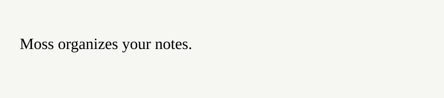

# Moss

Organize your notes into a readable daily digest.



More context about the application.

More context about the application.

More context about the application.

More context about the application.

More context about the application.

More context about the application.

More context about the application.

More context about the application.

More context about the application.

More context about the application.

More context about the application.

More context about the application.

More context about the application.

More context about the application.

More context about the application.

More context about the application.

More context about the application.

More context about the application.

More context about the application.

More context about the application.

More context about the application.

More context about the application.

More context about the application.

More context about the application.

## Quick start

```sh
npm install moss-web-app
```

## License

MIT.
