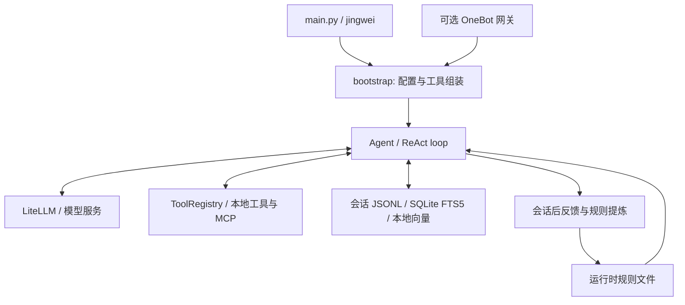

# 精卫 / Jingwei

**终端里的个人 Agent：用工具读写文件、执行命令，记住会话，每次结束后复盘并把经验攒成规则。**

Jingwei is a Python agent with tool execution, local memory, session reflection, and an optional message gateway.

[快速开始](#快速开始) · [核心能力](#核心能力) · [工具清单](#工具清单) · [架构与目录](#架构与目录) · [配置](#配置与数据位置) · [已知限制](#已知限制)

适合学习 Agent 的编排与记忆实现，或作为个人自动化的起点。名字取自精卫衔石填海：每次会话后复盘，把经验一点点攒成规则。

## 快速开始

需要 Python 3.12。在仓库根目录执行：

```bash
python3.12 -m venv .venv && .venv/bin/python -m pip install -r requirements.txt
cp .env.example .env
./jingwei "只回复：你好"
```

执行第三条前，在 `.env` 中填写自己的 `DEEPSEEK_API_KEY`。默认使用 `deepseek/deepseek-chat`，模型请求由你配置的服务计费。QQ 网关默认关闭。

## 核心能力

每项都写明验证到哪一步。

- **ReAct 循环**：模型返回工具调用，注册表执行工具并将结果交回模型，直到回答或达到 `JINGWEI_MAX_TURNS`。默认最大步数为 30；步数不等于请求费用上限，重试、子任务和复盘可能增加调用。
- **运行时工具注册**：`ToolRegistry` 支持注册、注销、生成调用定义、校验参数和派发。`manage_tool` 提供运行时管理入口。工具注册及本地文件调用有离线测试。
- **会话与长期记忆**：会话保存为 JSONL，并建立 SQLite 全文索引；长期知识保存在 SQLite，结合 FTS5 和本地 m3e-base 向量检索。FTS5 不可用时降级为关键词匹配。本地模型缺失或加载失败时保留关键词检索，不自动下载模型。已用准备好的 m3e-base 权重验证非零向量生成、SQLite 向量保存和一次检索往返；未做召回质量评测。
- **会话后复盘**：`on_session_end` 尝试提炼反馈、知识和重复任务模式；反馈规则写入 `agent_memory/skills/自学习技能/规则与偏好.md`，后续加入系统提示词。流程、存储和注入使用模拟模型验证；不承诺自动提炼的质量。
- **消息网关**：同一会话的连发消息在静默窗口内合并，推理期间的新消息可中断旧处理；按用量累计负载并触发冷却。离线测试覆盖这些场景，真实 QQ 收发需单独配置和验收。
- **MCP 客户端**：通过 stdio 初始化服务器、列出工具并调用工具。用本地独立 MCP 测试进程验证了完整往返。代码也保留 HTTP 适配，但未验收外部 HTTP MCP 服务。

## 工具清单

以下名称来自默认 `build_agent()` 的实际注册表。注册成功不代表每项外部服务已联通。

| 用途 | 默认注册工具 |
| --- | --- |
| 文件与命令 | `read_file`、`write_file`、`edit_file`、`bash` |
| 任务编排 | `spawn_agent`、`swarm`、`run_sequence`、`schedule_task` |
| 工具与记忆管理 | `manage_tool`、`save_memory`、`organize_notes`、`record_skill_usage` |
| 网页 | `web_search`、`web_fetch` |
| 媒体与浏览器 | `read_image`、`image2_generate`、`browser_agent` |
| MCP 与外部集成 | `mcp_client`、`stitch_generate`、`notebooklm`、`xiaohongshu` |

仅在 `QQ_ENABLED=true` 时额外注册 `get_qq_status`、`send_qq_message`、`send_image_to_qq`。Stitch、NotebookLM、小红书、图片和浏览器工具需要各自的服务、认证或浏览器调试连接；这些外部服务尚未做端到端验收。

## 架构与目录



| 路径 | 内容 |
| --- | --- |
| `agent/core/` | Agent 状态、ReAct、配置、模型接口与提示词 |
| `agent/tools/` | 注册表及文件、网页、媒体、编排、QQ、MCP 工具 |
| `agent/memory/`、`agent/session/` | 长期知识、向量与全文检索、会话持久化 |
| `agent/evolution/`、`agent/skills/` | 复盘、规则、经验与技能管理 |
| `agent/net_gateway/` | 消息接入、合并、输出与冷却 |
| `agent/runner/`、`agent/ui/` | 运行入口、终端与实验界面 |
| `config/settings.yaml`、`.env.example` | 默认配置与本地凭据模板 |
| `agent_memory/` | 运行时资产目录；仓库只保留空目录标记 |
| `tests/`、`.github/workflows/` | 离线测试与 CI |
| `docs/architecture/` | 当前架构说明与明确标注的历史设计提案 |
| `bin/`、`control/`、`agent/systemd/` | 需要自行检查配置的可选启动与服务模板 |

## 配置与数据位置

配置优先级为：进程环境变量 > `.env` > `config/settings.yaml`。每一层内 `JINGWEI_*` 优先于 `MYAGENT_*`、`XL_*`（按此顺序兼容读取），旧名的进程环境仍优先于新名的 `.env` 或 YAML；显式空值也保留这一顺序。凭据只写入本地 `.env` 或环境变量；不要提交会话、数据库、日志和登录数据。

默认长期记忆位于 `~/.jingwei/memory`，会话位于 `~/.jingwei/sessions`；技能和规则位于项目的 `agent_memory/`。目录在需要时创建，项目内记忆备份默认关闭。设置 `JINGWEI_DATA_DIR` 可覆盖运行时数据根目录，各单项路径变量优先于根目录；YAML 中显式设置的 `memory.base_dir` 也继续生效。技能目录仍可通过 `JINGWEI_AGENT_MEMORY_DIR` 覆盖。默认不读取任何个人笔记目录。

启动时若 `~/.xl-agent` 存在而 `~/.jingwei` 不存在，会在终端提示；不会自动移动或删除数据。可先设置 `JINGWEI_DATA_DIR=~/.xl-agent` 继续使用旧数据，或备份后自行迁移到新目录。

`./xl` 保留为兼容别名（旧名，后续移除），参数和退出码与 `./jingwei` 相同。

要使用本地向量检索，先自行准备 m3e-base 模型，放入 `model/m3e-base`，或修改 YAML 的 `memory.local_model_path`。模型权重不随代码分发。`EMBEDDING_MODE=cloud` 是可选在线模式，需要 embedding 服务凭据并可能额外计费。

要启用 QQ，设置 `QQ_ENABLED=true`、`QQ_ADMIN_ID`、NapCat 地址与令牌，再按需填写用户和群白名单，运行 `python main.py --gateway`。详见[网关说明](docs/architecture/GATEWAY_CSMA_FATIGUE.md)。普通 CLI 使用 `./jingwei` 进入交互模式，`./jingwei --help` 查看帮助；`./jingwei "问题"` 是单次入口。

## 测试

```bash
.venv/bin/python -m pip install -r requirements-dev.txt
.venv/bin/python -m pytest -q
```

CI 默认使用 GitHub 托管 Ubuntu 和 Python 3.12 安装依赖并运行离线测试，不需要真实 key。托管 runner 暂未运行，目前以本地 pytest 结果为准。测试拦截网络连接，并将记忆和会话放入临时目录。真实 QQ 联通用例明确跳过，需要登录账号、OneBot、模型和语音服务，不能算作离线验证通过。

## 已知限制

- 只用少量 DeepSeek 请求确认过单次文字对话，未测量长期稳定性、吞吐量、成本节省或回答正确率。
- `bash`、文件写入和运行时 Python 工具注册可以操作本机；现有权限判断不能替代操作系统沙箱。请在隔离环境中使用，不要向不可信用户开放。
- 复盘会发起额外模型请求；短会话可能不触发，单次命令退出时后台工作也可能尚未完成。提炼规则可能错误，应人工检查并按需删除运行时规则。
- 本地向量模型需要另行下载并占用内存；缺少模型时语义检索不可用。关键词降级的效果与 FTS5/向量检索不同。
- `ContextCompressor` 当前只估算 Token，自动压缩已停用。上下文长度和模型输出仍有边界。
- 网页、QQ、语音、图片、NotebookLM、小红书及 Stitch 依赖外部环境；这些服务尚未登录验收。Stitch 返回的离线模板不表示远端生成成功。
- Docker、launchd、自动学习、圆桌及像素界面保留为可选或实验部分，未做部署和界面验收。`--douyin` 的独立网关实现已移除。

## 来源与许可

代码从作者早期的个人仓库导出，未携带旧 Git 历史；旧归档、个人记忆及本地配置未迁入。代码中保留了参考 Hermes 等项目的说明。

本仓库采用 [MIT License](LICENSE)。外部模型权重与第三方素材的许可由各自来源决定。
